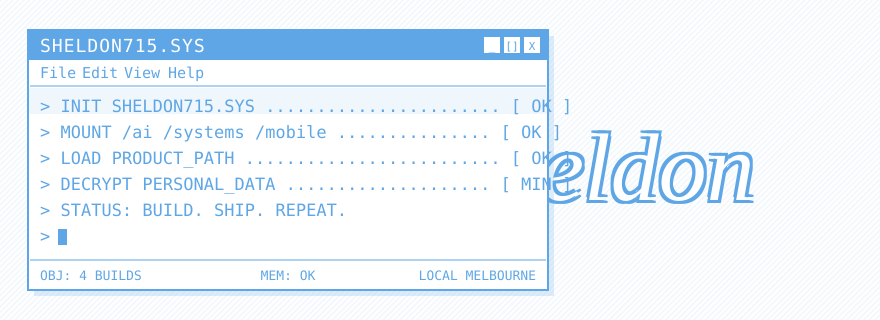

<div align="center">

<picture>
  <source media="(prefers-color-scheme: dark)" srcset="./header.svg">
  
</picture>

<br /><br />

[](https://github.com/Sheldon715)

</div>

<br />

```console
sheldon715@localhost:~$ whoami

  ID .............. Sheldon Liu
  DOMAIN .......... AI × full-stack engineering
  MODE ............ product → system → release
  BIO ............. [ BUILDING ]
  LOCATION ........ Melbourne, AU
  STATUS .......... online // building
```

<div align="center">

`the system should be useful before it is impressive`

</div>

<br />

## `~/system` &nbsp;// &nbsp;operating principles

```text
[KERNEL]
  translate     turn a product need into a dependable system
  connect       move from interface to service, data, AI, and deploy
  verify        test the path, measure behavior, inspect failure
  rebuild       keep the useful parts and improve the weak ones

[POLICY]
  application_data  controls product facts and business actions
  retrieval         grounds answers in relevant evidence
  noise              muted
  signal             shipped
```

<br />

## `~/stack` &nbsp;// &nbsp;loaded modules

<div align="center">


</div>

<div align="center">

`AI / RAG` &nbsp;·&nbsp; `LLM APIs` &nbsp;·&nbsp; `Qdrant` &nbsp;·&nbsp; `recommendations` &nbsp;·&nbsp; `evaluation` &nbsp;·&nbsp; `prompt engineering`

</div>

<br />

## `~/telemetry`

<div align="center">

<picture>
  <source media="(prefers-color-scheme: dark)" srcset="https://raw.githubusercontent.com/Sheldon715/Sheldon715/gh-pages/github-contribution-grid-snake-dark.svg">
  
</picture>

</div>

<!-- Visual layout adapted from https://github.com/serein431/serein431;
     personal content belongs to Sheldon Liu. Embedded VT323 font by Peter Hull. -->

<br />

<div align="center">


</div>
